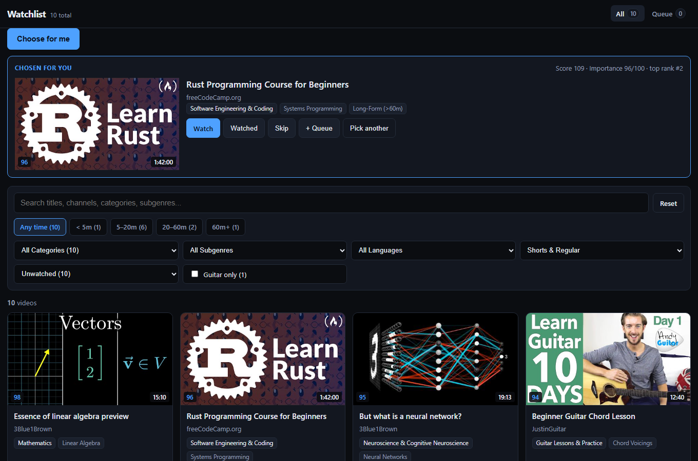
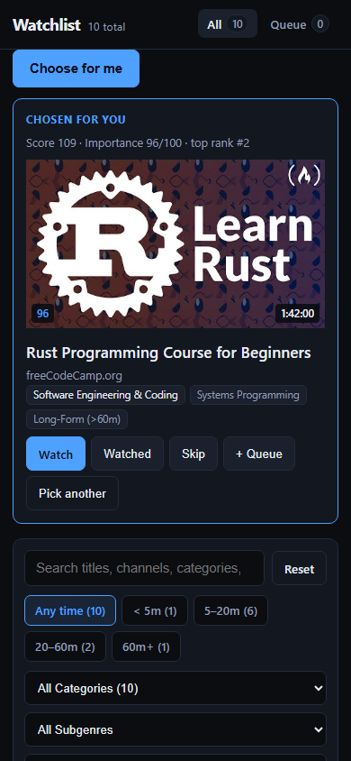

# Watchlist

**A fast, minimalist, self-hosted YouTube Watch Later discovery app built with Rust, Axum, SQLite FTS5, Askama, and HTMX.**


Stop endlessly scrolling through thousands of saved YouTube videos. **Watchlist** imports your categorized video CSV into a local SQLite database and helps you decide **what to watch right now** based on available time, topic, and an explainable local recommendation engine—with zero JavaScript frameworks, zero embedded players, and zero external AI APIs.

---

## Screenshots

*(Captured using the included public [`demo/sample_watchlist.csv`](demo/sample_watchlist.csv) dataset.)*

### Desktop


### Mobile


---

## Features

- **Focused Two-View Interface:** Just **All** (unwatched by default) and **Queue**—no social clutter, no bloated feeds.
- **Pick by Available Time:** One-tap duration pills (`< 5m`, `5–20m`, `20–60m`, `60m+`) with live video counts.
- **Instant SQLite FTS5 Full-Text Search:** Search across titles, channels, categories, and subgenres with full **Arabic/RTL** and English support.
- **Counts Everywhere:** Every Category, Subgenre, Duration pill, and Guitar-only toggle displays exact unwatched video counts.
- **"Choose for me" Recommendation Engine:** Lightweight, explainable local scoring combining `importanceScore`, `rank`, learned category/subgenre/duration/language preferences, and anti-repeat diversity.
- **Clean Data Separation:** Original CSV metadata (`videos`) is never overwritten; personal actions (`Watched`, `Skip`, `+ Queue`) and preference weights live separately in `user_activity` and `user_preferences`.
- **Idempotent CSV Importer:** UTF-8 BOM-safe, validates YouTube IDs/URLs, detects duplicates, handles missing channels, prints an import report, and automatically backs up your SQLite database before re-importing.
- **Tiny Footprint:** Single Rust binary, server-rendered Askama HTML, custom dark-first CSS, and vendored `htmx.min.js` (`50 KB`). No Node/npm/React build pipeline.

---

## Quick Start

### 1. Prerequisites
- [Rust](https://rustup.rs/) (stable toolchain)

### 2. Run with the Included Demo Dataset
```bash
git clone https://github.com/SamDozer/watchlist.git
cd watchlist

# Run unit & FTS5 integration tests
cargo test

# Import the public demo CSV and start the local server
cargo run -- --import demo/sample_watchlist.csv --serve --port 3000
```

Open **http://127.0.0.1:3000** in your browser.

### 3. Import Your Own CSV
Your personal CSV and SQLite database are ignored by `.gitignore` and never modified:

```bash
cargo run -- --db ./data/watchlist.db --import /path/to/your_videos.csv --serve
```

### CLI Options
| Flag | Description | Default |
|---|---|---|
| `--db <path>` | SQLite database file path | `./data/watchlist.db` |
| `--import <csv>` | Import or update videos from CSV (auto-backs up DB first) | — |
| `--serve` | Start the HTTP server after `--import` | `false` |
| `--port <port>` | Port to bind on `127.0.0.1` | `3000` |

---

## CSV Format

Watchlist expects a UTF-8 CSV (with or without BOM) with these 14 headers:

```text
rank,importanceScore,language,watchTimeBucket,category,subgenre,isGuitar,isShort,classifiedBy,videoId,title,channel,duration,url
```

---

## Architecture

```text
watchlist/
├── Cargo.toml
├── LICENSE
├── migrations/
│   └── 0001_init.sql          # videos, videos_fts (FTS5 + triggers), user_activity, user_preferences
├── src/
│   ├── main.rs                # CLI & 127.0.0.1 Axum server
│   ├── db.rs                  # SQLite WAL pool, migrations, FTS5 check, pre-import backup
│   ├── import.rs              # BOM-safe, idempotent CSV importer + import report
│   ├── discovery.rs           # FTS5 query builder, counts, "Choose for me", activity actions
│   ├── models.rs              # Typed SQLx rows & filter params
│   └── routes.rs              # Axum handlers & Askama/HTMX templates
├── templates/                 # Server-side Askama HTML templates
├── static/                    # Custom dark-first CSS + vendored htmx.min.js
└── demo/
    └── sample_watchlist.csv   # Public educational sample dataset
```

---

## Tech Stack

- **Backend:** Rust, [Axum](https://github.com/tokio-rs/axum), [Tokio](https://tokio.rs/), [SQLx](https://github.com/launchbadge/sqlx) (SQLite + FTS5)
- **Templates & Frontend:** [Askama](https://github.com/djc/askama), [HTMX](https://htmx.org/), custom responsive CSS

## License

[MIT](LICENSE)
